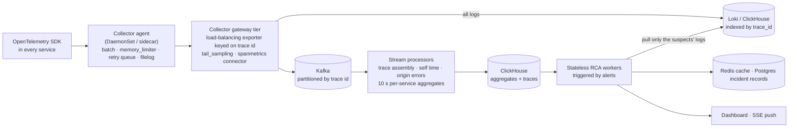

# Automated Root-Cause Analysis for Microservices

When a request through a chain of microservices gets slow or fails, **which service is actually to blame?**
This project answers that automatically, using OpenTelemetry traces, metrics and logs.

It contains five instrumented services, a fault injector, an RCA engine that ranks likely culprits, a live
dashboard, and an evaluation harness that measures how often the ranking is right.

**Live demo (free, runs entirely in your browser):** https://microservice-rca.adityayadav7868.workers.dev

## In plain words

Imagine an online checkout. The **gateway** calls **orders**, and orders calls **payments** and **inventory**. If
payments gets slow, then orders is slow (it waits), and the gateway is slow (it waits too). All three *look*
broken, but only one *is*. On-call engineers spend a lot of time working out which.

This system watches every request, works out how much time each service spent **on its own work** versus
**waiting on others**, compares that with what is normal, and says: *"payments is the most likely root cause,
here is the evidence."*

## What it does

| Capability | How |
|---|---|
| Instrumented services | 5 Node/TypeScript services emit OpenTelemetry **traces**, **metrics** and **structured JSON logs** |
| Dependency graph | Discovered automatically from traces (no config) |
| Anomaly detection | Per-service **self time** and **origin errors** vs a baseline, using robust statistics (median/MAD) |
| Root-cause ranking | 5 weighted signals: self time, errors, critical-path share, who went wrong first, deepest-in-graph |
| Evidence | Plain-English reasons + the top error logs, joined to traces by trace id |
| Trace-ID sampling | Keep 100% / 25% / 5% of traces, decided by trace ID so kept traces are complete; failed and slow traces are always kept as evidence |
| Everything view | One screen: all services, every log line, failed requests, and a per-request inspector with every log that request produced |
| Free hosted demo | A static **simulation mode** (the real engine running in the browser on simulated telemetry) that deploys to Cloudflare Pages for free, with no server to exploit |
| Guided dashboard | A five-step walk-through: traffic, break something, symptom, cause, proof. Plain-English verdict, graph, own-work-vs-waiting chart, traces, logs |
| Evaluation | Injects known faults and reports top-1/top-3 accuracy, time to detect and false alarms |

## Architecture

Two views, kept honest: the **proposed architecture** this design scales into, and the **implemented architecture** in this repository.

### 1 · Proposed architecture (production scale)

The target design for production scale, shaped by the measured limits of the single-node engine (see [docs/06](docs/06-production-guide.md)). It is a **proposal, not code in this repo**; section 2 below is what is actually built:



| Concern | Design |
|---|---|
| Ingest fan-in at scale | OpenTelemetry Collector agent → gateway tier, with **trace-ID-keyed load balancing** so every span of a trace lands on one processor |
| Unbiased statistics under sampling | The **spanmetrics connector** derives rate/error/latency (RED) metrics from the *unsampled* stream; **tail sampling** keeps all errors and slow traces plus a small share of normal ones |
| Burst absorption, replay, backpressure | **Kafka**, partitioned by trace id, with consumer groups autoscaled on lag |
| Constant-size analysis input | The trace assembly and self-time logic from this repo moves into **stream processors** that emit per-service, per-10 s aggregates, so analysis cost stops depending on traffic |
| Storage | Columnar store (ClickHouse) for aggregates and traces, a log store (Loki or ClickHouse) indexed by `trace_id`, object storage for cold data |
| Logs | **Pull, don't push**: logs stay in the log store and the RCA queries only the suspect services, the incident window and the trace ids |
| Horizontal scale of the RCA itself | **Stateless workers** triggered by alerts, with Redis for cached baselines and Postgres for incident history |
| Operability | Meta-monitoring: alerts on Kafka lag and on drop counters |

Details and measured numbers: [docs/06 · Production guide](docs/06-production-guide.md). Full diagram of the implemented system with click-through detail: [docs/01-architecture.md](docs/01-architecture.md).

### 2 · [Implemented architecture (this repo) →](docs/09-implemented-architecture.md)

The diagram and the techniques actually used (parallel fan-out, fan-in trace assembly, trace-ID-consistent sampling, bounded buffers, critical-path attribution, ports-and-adapters, ...) are on their own page: **[docs/09 · Implemented architecture](docs/09-implemented-architecture.md)**.

## Quick start

Requires **Node.js 20+** and **Docker** (for the real Postgres and Redis the services talk to).

```bash
npm install
npm run db:up                  # starts Postgres + Redis in Docker (ports 55432 / 56379)
npm start                      # creates the schema, then starts the RCA engine + 5 services
```

Open **http://127.0.0.1:4318**. The page is a guided five-step walk-through: start traffic, break something, see
the symptom, find the cause, check the proof. Everything can be done with buttons; no other terminal is needed.

**No Docker?** Run the simulation instead: `npm run demo` (also what the free hosted version uses; see [docs/08](docs/08-deploy-free-and-security.md)).

Press **Everything** (top bar) for the one-screen view: all services, every log line and a per-request inspector. See [docs/07](docs/07-everything-view.md).

Prefer the command line?

```bash
npm run load -- 20                       # 20 requests/second of traffic
npm run chaos -- payments latency 200    # slow a service
npm run chaos -- postgres latency 200    # slow the REAL Postgres (also: redis)
npm run chaos -- inventory errors 0.5    # 50% of inventory requests fail
npm run chaos -- orders cpu 30           # CPU burn blocks the event loop
npm run chaos -- all clear               # undo everything
```

Measure accuracy (about 12 minutes with 2 repetitions, starts its own stack, so stop `npm start` first):

```bash
npm run eval -- --reps 2
npm run bench                            # how much telemetry one engine process can take
```

## How the ranking works, in five steps

1. **Self time.** For each request, subtract the time spent waiting on downstream calls from the total. What is
   left is the time the service spent on its *own* work.
2. **Compare with normal.** A robust z-score (median/MAD) of self time and of *origin errors* (errors not caused
   by a failing dependency) against the period just before.
3. **Walk the graph.** Blame flows to the deepest anomalous service, because callers merely inherit slowness.
4. **Weigh the evidence.** Critical-path share in slow traces, and which service went wrong first.
5. **Explain.** Return a ranked list with human-readable evidence and the matching error logs.

**Step-by-step walkthrough with formulas and a real worked example → [docs/03-rca-engine.md](docs/03-rca-engine.md)**

## Results

Single-fault evaluation against the real databases: 5 services × 3 fault types, plus Postgres and Redis slowdowns, 2 repetitions, plus fault-free controls.

| Metric | RCA engine | Naive: highest p95 | Naive: highest latency ratio |
|---|---|---|---|
| Correct service or database ranked #1 | **34/34** | 6/34 | 23/34 |
| Correct one in top 3 | **34/34** | n/a | n/a |
| Median time to rank it #1 | **2 s** | n/a | n/a |
| False alarms on healthy runs | **0/4** | n/a | n/a |

These are single-fault trials on a small synthetic system, with thresholds tuned using the same harness. Read the
caveats in [docs/04-chaos-and-evaluation.md](docs/04-chaos-and-evaluation.md#how-to-read-these-numbers-honestly)
before quoting them anywhere.

## Topics worth learning (to understand this project)

| Topic | Why it matters here |
|---|---|
| Logs vs metrics vs traces | The three telemetry signals the system is built on |
| Distributed tracing & context propagation | How spans from 5 processes become one request tree (`traceparent` header) |
| OpenTelemetry & OTLP | The vendor-neutral standard used to produce and ship telemetry |
| Tail latency (p95/p99) | Why averages hide the requests users actually suffer |
| Self time vs total time, critical path | The idea that separates the cause from the victims |
| Robust statistics (median, MAD) | Why the detector isn't fooled by outliers |
| Cascading failures, error propagation | Why a slow dependency makes every caller look broken |
| Chaos engineering | How the system is tested with deliberately injected faults |
| Node.js event loop | Why CPU burn in one request hurts all concurrent requests |

**Each topic with a one-line explanation, where it appears in the code, a glossary and likely interview questions →
[docs/05-learning-guide.md](docs/05-learning-guide.md)**

## Documentation index

| Doc | Read it to understand |
|---|---|
| [01 · Architecture](docs/01-architecture.md) | The big picture, request flow, ports, design decisions |
| [02 · Services & telemetry](docs/02-services-and-telemetry.md) | What each service does and exactly what telemetry it emits |
| [03 · RCA engine](docs/03-rca-engine.md) | The algorithm, every formula, a worked example, limitations |
| [04 · Chaos & evaluation](docs/04-chaos-and-evaluation.md) | Fault injection, the test harness, results and caveats |
| [05 · Learning guide](docs/05-learning-guide.md) | Topics to study, glossary, interview questions |
| [06 · Production guide](docs/06-production-guide.md) | How real logs and traces get in, how to read the output, sampling, what happens at huge volume |
| [07 · Everything view](docs/07-everything-view.md) | The one-screen layout for working an incident, and how to read it |
| [09 · Implemented architecture](docs/09-implemented-architecture.md) | The diagram and the techniques this repo actually implements |
| [08 · Deploy free & security](docs/08-deploy-free-and-security.md) | Simulation mode, deploying to Cloudflare Pages, and why visitors can't exploit it |

## Project structure

```
src/
  shared/
    config.ts        topology: services, ports, who calls whom
    telemetry.ts     OpenTelemetry setup (traces + metrics), imported first by every service
    logger.ts        JSON logs carrying trace_id / span_id
  services/
    service.ts       the one generic service, run 5 times with different config
  rca/
    server.ts        OTLP receiver + HTTP API + serves the dashboard
    otlp.ts          decodes OTLP JSON into spans and metric points
    store.ts         in-memory telemetry store with hard caps
    dbchaos.ts       fault injection inside the real Postgres / Redis
    analyze.ts       self time, anomaly detection, graph, ranking   <- the core
    stats.ts         median, MAD, percentiles, interval union
  tools/
    launcher.ts      creates DB schema, starts everything   (npm start)
    dbsetup.ts       Postgres schema + Redis seed data      (npm run db:setup)
    bench.ts         ingest / analysis throughput benchmark (npm run bench)
    loadgen.ts       constant-rate traffic      (npm run load)
    chaos.ts         fault injector CLI         (npm run chaos)
    evaluate.ts      accuracy harness           (npm run eval)
dashboard/index.html single-file guided dashboard, no build step
docker-compose.yml   real Postgres 16 + Redis 7
docs/                the detailed documentation
```

## Limitations

* The engine is a single node with a bounded, 10-minute retention store. Durable storage, a buffering queue and Collector-tier tail sampling are part of the proposed architecture, not of this repo.
* Only synchronous HTTP calls form the graph; queues and async messaging are not modelled.
* The baseline is the 40 seconds before the window, so a fault that lasts longer gradually looks "normal".
* Simultaneous faults in different services are both reported but the ordering between them is less reliable.
* Databases only support latency faults (a real slowdown); error and CPU faults are service-level.
* One engine process is the scaling limit (measured at about 8,600 traces/s ingest, and analysis cost grows with traffic): see [docs/06-production-guide.md](docs/06-production-guide.md) for the measured limit and what to do about it.
* Metrics are collected and exposed at `/api/metrics`, but the ranking is driven by traces.

More in [docs/03-rca-engine.md](docs/03-rca-engine.md#limitations-worth-saying-out-loud).

## Tech stack

Node.js · TypeScript (run with `tsx`) · OpenTelemetry JS SDK 1.x · OTLP/HTTP · PostgreSQL 16 · Redis 7 · Docker · Mermaid diagrams (rendered by GitHub)
