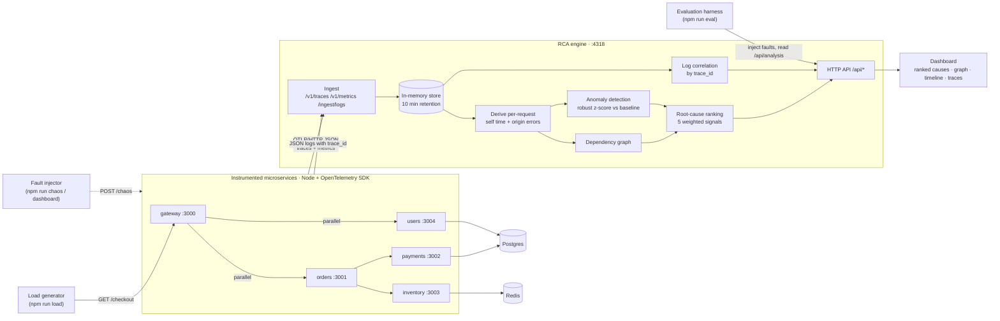
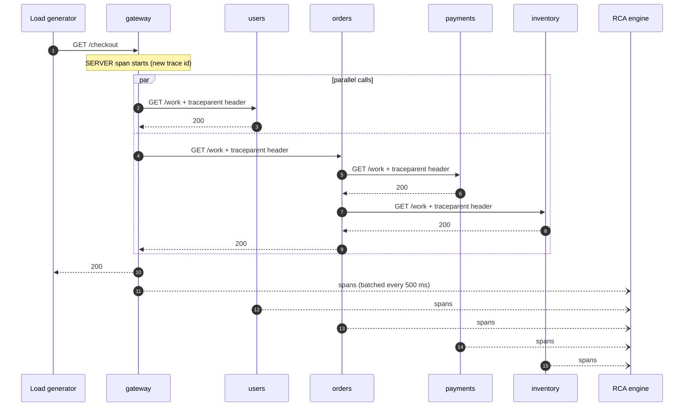

# 01 · Architecture (High-Level Design)

← [Back to README](../README.md)

## The 30-second version

Five small services call each other. Each one reports what it does (traces, metrics, logs) to a single
**RCA engine**. When something gets slow or starts failing, the engine looks at the data, works out *which
service is actually at fault*, and shows a ranked list on a dashboard.

## HLD diagram

Click-through detail for every box:

| Box | What it is | Detailed doc |
|---|---|---|
| Microservices | One generic Node service started 5 times with different config | [02 · Services & telemetry](02-services-and-telemetry.md) |
| Ingest, store, derive | Receives OTLP, keeps 10 minutes in memory, computes per-request numbers | [03 · RCA engine](03-rca-engine.md) |
| Graph, anomaly detection, ranking | The actual root-cause algorithm | [03 · RCA engine](03-rca-engine.md) |
| Fault injector, evaluation | Proves the ranking is right | [04 · Chaos & evaluation](04-chaos-and-evaluation.md) |
| Dashboard | A guided five-step page (traffic, break, symptom, cause, proof), a single static HTML file | [dashboard/index.html](../dashboard/index.html) |
| Production use | How real traffic gets in and what happens at scale | [06 · Production guide](06-production-guide.md) |

## What happens to one request

The `traceparent` header (W3C Trace Context) carries the **trace id** and the **parent span id** across the
network. That is the one mechanism that lets the engine stitch spans from five different processes back
into a single request tree.

## Ports

| Port | Process |
|---|---|
| 4318 | RCA engine: OTLP receiver, API, dashboard (4318 is the standard OTLP/HTTP port) |
| 3000 | gateway (entry point, `GET /checkout`) |
| 3001 | orders |
| 3002 | payments |
| 3003 | inventory |
| 3004 | users |
| 55432 | Postgres 16 (Docker) |
| 56379 | Redis 7 (Docker) |

## Design decisions

| Decision | Why |
|---|---|
| One generic service, five configs | The topology lives in [src/shared/config.ts](../src/shared/config.ts). Adding a service is a few lines, not a new codebase. |
| The RCA engine speaks plain OTLP/HTTP | The services only know the OTLP protocol, so you could point them at a real OpenTelemetry Collector, Jaeger or Tempo without changing service code. |
| Everything in memory | Keeps the demo to `npm install && npm start`. A production system would use ClickHouse/Tempo/Loki; see limitations in the README. |
| Analysis is computed on demand | No background pipeline to get out of sync. Per-trace results are cached until a new span for that trace arrives. |
| Real Postgres and Redis | Databases are where many real incidents start. They run in Docker, are traced by the standard `pg`/`ioredis` instrumentation, and appear as nodes in the graph, so the engine can blame them. |
| CommonJS, not ESM | OpenTelemetry patches `node:http` when it is first `require`d. CommonJS makes that import order reliable; ESM would need extra loader hooks. |
