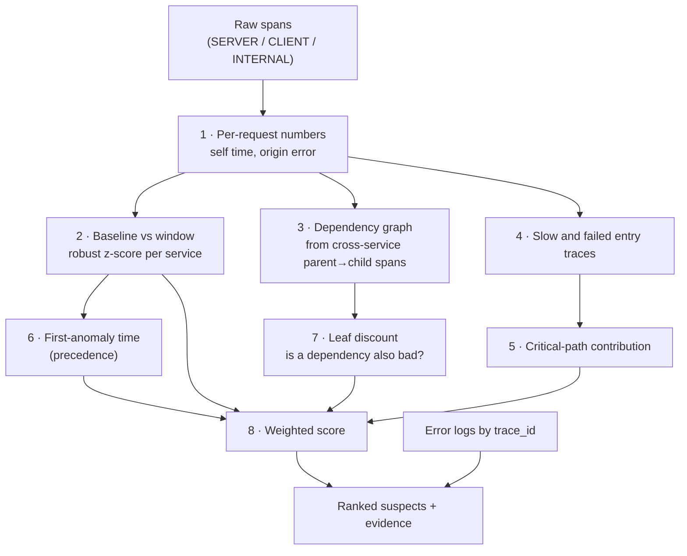

# 03 · The RCA engine, step by step

← [Back to README](../README.md) · Previous: [02 · Services & telemetry](02-services-and-telemetry.md) · Next: [04 · Chaos & evaluation](04-chaos-and-evaluation.md)

Code: [src/rca/analyze.ts](../src/rca/analyze.ts) (the algorithm) · [src/rca/otlp.ts](../src/rca/otlp.ts) (decoding) ·
[src/rca/store.ts](../src/rca/store.ts) (storage) · [src/rca/stats.ts](../src/rca/stats.ts) (maths) ·
[src/rca/server.ts](../src/rca/server.ts) (HTTP API)

## The question being answered

> The gateway's `/checkout` got slow (or started failing). **Which service is responsible?**

The hard part: when `payments` is slow, `orders` and `gateway` are slow *too*, because they wait for it. A naive
"find the slowest service" always points at the gateway. The engine's job is to separate the **cause** from the
**victims**.

## Pipeline overview



## Time windows

Every analysis compares two periods that touch each other:

```
 ◄────────── baseline (default 40 s) ──────────►◄── window (default 8 s) ──►│ now − 1 s lag
          "what normal looks like"                  "what we are diagnosing"
```

* The **window** is what we are diagnosing.
* The **baseline** is the period right before it.
* `now` is shifted back 1 s (`lag`) so spans still in flight from the 500 ms export batching don't make the
  newest traces look incomplete.

## Step 1: self time

A SERVER span's **total time** includes time spent waiting on other services. **Self time** removes that:

```
self = server_span.duration − union(CLIENT child span intervals)
```

* Only **CLIENT** children are subtracted: calls to other services and database queries. INTERNAL spans
  (`compute`, `chaos.latency`) count as the service's own time. So do database *connection/pool-wait* spans,
  because pool exhaustion is the service's own problem.
* The **union** of intervals is used, so parallel calls (the gateway calling `users` and `orders` at once) are
  not double-counted. See `unionLength()` in [stats.ts](../src/rca/stats.ts).

Why this matters: if `payments` adds 200 ms, `payments`'s self time rises by 200 ms. `orders` and `gateway`
see a *total* time rise of 200 ms, but their self time does not change. They were only waiting.

## Step 2: anomaly detection (baseline vs window)

For each service the engine splits baseline requests into 1-second buckets and takes the mean self time of
each bucket. That gives a list of "what a normal second looks like". Then:

```
median    = median(bucket means)
scale     = max( 1.4826 × MAD(bucket means),  0.15 × median,  0.5 ms )
z         = (mean self time in window − median) / scale
```

A service is **self-time anomalous** only if *all three* hold, which keeps noise from triggering it:

| Condition | Why |
|---|---|
| `z ≥ 3` | Statistically unusual |
| `current ≥ 1.3 × baseline median` | A real relative jump |
| `current − baseline ≥ 5 ms` | A real absolute jump (tiny services have huge relative noise) |

Self-time score = `clamp((z − 3) / 9, 0, 1)`. Median/MAD is used instead of mean/standard deviation because
latency data is spiky and a few outliers would otherwise make the detector blind to the incident.

**Error signal.** An error is an **origin error** when the span failed *and none of its CLIENT children failed*:

```
origin = span.error AND NOT any(child CLIENT span has error)
```

If `payments` returns 500, `payments` has an origin error; `orders` and `gateway` return 502 but their client
span to the failing service errored, so they do **not** count as origin. Error score =
`clamp((origin rate in window − baseline median origin rate) / 0.25, 0, 1)`, and at least 2 origin errors are
required.

A service needs at least 5 requests in both the window and the baseline, or it is reported as `no data`.

## Step 3: the dependency graph

The graph is **discovered, never configured**. Whenever a SERVER span's parent is a CLIENT span belonging to a
*different* service, that is a call edge `caller → callee`. Per edge the engine tracks call count, error rate
and p95 latency. The dashboard draws it; the ranking uses it for the leaf discount in step 7.

### Databases are nodes too

A database has no SERVER span, so the engine uses the query's CLIENT span as a stand-in: its whole duration
is the database's "self time", an error on it is an origin error, and the call forms an edge
`service → postgres` or `service → redis`. The databases are then scored exactly like services.

Consequence: if Postgres slows down, `payments` and `users` don't change their *self* time (the time moved
into the query), but `postgres` does, so `postgres` is blamed and both callers show as "affected (inherited)". A
shared dependency that is slow is found, instead of two unrelated services being blamed.

## Step 4: slow and failed entry traces

"Entry" is the gateway: what the user experienced. In the window:

* A trace is **slow** if the entry duration ≥ `max(1.6 × baseline median, baseline median + 15 ms)`.
* A trace is **failed** if the entry span has an error.

The median (not p95) is used for the threshold so a baseline partly contaminated by the very start of the
incident doesn't hide the slowness.

## Step 5: critical-path contribution

For each slow trace, take each service's share of the entry duration that was *its own self time*:

```
share(service, trace) = Σ self time of that service in the trace / entry duration
```

Average over slow traces, subtract the same average over baseline traces. A service whose share of the
end-to-end time grew by 35 percentage points scores 1. For failed traces, the score is the fraction of failed
traces in which that service holds the origin error. The two are combined with `max`.

## Step 6: temporal precedence

For every anomalous service the engine finds the first 1-second bucket in the window that looks wrong. The
service that went wrong **first** gets precedence 1; later ones decay linearly to 0 over 60% of the window.
A root cause starts the incident; victims join afterwards.

## Step 7: the leaf discount

If a service has a downstream dependency (from the graph) whose own score is above 0.3, then some of its
slowness may be inherited. Its `leaf` signal is set to 0.3 instead of 1. Blame flows to the **deepest**
anomalous service.

## Step 8: the final score

```
score = 0.35 · selfTime
      + 0.25 · errors
      + 0.20 · criticalPath
      + 0.10 · precedence
      + 0.10 · leaf
```

(`WEIGHTS` in [analyze.ts](../src/rca/analyze.ts).) Only services that are themselves anomalous in step 2 get
a score, so healthy services never appear. Suspects are returned most-likely-first, each with a human-readable
**evidence** list and its top error logs.

An incident is declared when the top suspect scores at least 0.3.

Service roles shown on the dashboard:

| Role | Meaning |
|---|---|
| root-cause suspect | Its own self time or origin errors are anomalous |
| affected (inherited) | p95 or errors are up, but its own self time is normal: it is a victim |
| healthy | Nothing unusual |
| no data | Fewer than 5 requests in the window or baseline |

## Step 9: log correlation

For each of the top three suspects, error-level log lines in the window are grouped by message. The top
messages and counts are returned, along with an example trace id, so you can jump from "payments is the
suspect" to "…because it logged `injected failure` 47 times".

## Naive baselines (for honest comparison)

The same response includes two naive rankings, used by [the evaluation](04-chaos-and-evaluation.md):

* **highest p95**: blame the service with the slowest total time.
* **highest latency ratio**: blame the service whose p95 grew the most compared with baseline.

## Worked example (real output)

Setup: 20 req/s of load, then `npm run chaos -- payments latency 200`. Ten seconds later, `GET /api/analysis?window=8&baseline=20`:

| Service | Verdict | Self time (normal → now) | p95 total (normal → now) |
|---|---|---|---|
| gateway | affected (inherited) | 3.6 → 3.7 ms | 178 → 296 ms |
| orders | affected (inherited) | 7.2 → 7.2 ms | 174 → 293 ms |
| **payments** | **root-cause suspect** | **19.3 → 220.8 ms (z = 69.6)** | 161 → 276 ms |
| inventory | healthy | 7.6 → 7.7 ms | 10 → 10 ms |
| users | healthy | 12.8 → 13.0 ms | 17 → 16 ms |

The gateway and orders *look* just as slow as payments in total time, but their self time did not move, so they
are marked as victims. Only payments' own time exploded. Its score:

```
selfTime 1.00 × 0.35 = 0.35      (z = 69.6, saturated)
errors   0.00 × 0.25 = 0.00      (no failures in this fault type)
critical 1.00 × 0.20 = 0.20      (+41 points of the critical path in slow traces)
first    1.00 × 0.10 = 0.10      (only anomalous service, so first)
leaf     1.00 × 0.10 = 0.10      (no anomalous dependency below it)
                       ----
score                   0.75
```

## Limitations (worth saying out loud)

| Limitation | Consequence |
|---|---|
| Baseline contamination | A fault that lasts longer than the baseline length gradually becomes "normal". Production systems use longer, seasonal baselines. |
| One window length | Very short blips (< 1 bucket) or slow drifts are missed. |
| Clock skew is ignored | Self time assumes parent and child timestamps are comparable. Across real hosts you'd need to account for skew. |
| Synchronous HTTP only | Queues, async messaging and fan-out jobs don't form simple parent/child edges. |
| 100% sampling, in memory | Real systems need tail-based sampling and durable storage. |
| Multiple simultaneous faults | Each is scored on its own signals, so both are reported, but their relative order is less reliable. |
| Weights are hand-set | They were chosen by reasoning and checked with the evaluation, not learned. |
