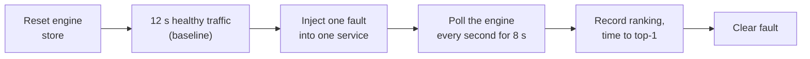

# 04 · Chaos & evaluation

← [Back to README](../README.md) · Previous: [03 · RCA engine](03-rca-engine.md)

Code: [src/tools/chaos.ts](../src/tools/chaos.ts) · [src/tools/loadgen.ts](../src/tools/loadgen.ts) · [src/tools/evaluate.ts](../src/tools/evaluate.ts)

A detector with no test is just a guess. This part of the project **breaks the system on purpose, with a
known answer, and checks whether the engine finds it.**

## Fault injection

```bash
npm run chaos -- payments latency 200   # +200 ms of waiting inside payments
npm run chaos -- inventory errors 0.5   # 50% of inventory requests fail with HTTP 500
npm run chaos -- orders cpu 30          # 30 ms of CPU burn per request (blocks the event loop)
npm run chaos -- postgres latency 200   # make the REAL Postgres 200 ms slower per query (also: redis)
npm run chaos -- payments clear         # remove faults from one service
npm run chaos -- all clear
```

You can also use the "Inject a fault" panel on the dashboard. What each knob simulates is explained in
[02 · Services & telemetry](02-services-and-telemetry.md#fault-injection-the-chaos-knobs).

## Load

```bash
npm run load -- 20        # 20 requests/second until Ctrl+C
npm run load -- 20 60     # 20 requests/second for 60 seconds
```

## The evaluation harness

```bash
npm run eval               # full run: 17 fault trials + 2 controls per repetition (about 7 min)
npm run eval -- --reps 2   # repeat everything (what the numbers below used)
npm run eval -- --quick    # 3 trials, a smoke test
```

It starts the whole stack itself, then for each trial:



Trials cover **5 services × 3 fault types** (latency 200 ms, 50% errors, 30 ms CPU burn), **two real database
faults** (Postgres 200 ms slower per query, Redis stalled with `DEBUG SLEEP`), plus **fault-free control trials**
to catch false alarms. Each trial also records what two *naive* strategies would have answered:

* **highest p95**: blame whatever service has the slowest total latency.
* **highest latency ratio**: blame whichever service's p95 grew the most relative to baseline.

## Results

Run with `--reps 2` at 20 req/s against real Postgres and Redis: 34 fault trials and 4 fault-free controls.

| Metric | RCA engine | Naive: highest p95 | Naive: highest latency ratio |
|---|---|---|---|
| Correct culprit ranked #1 | **34/34 (100%)** | 6/34 (18%) | 23/34 (68%) |
| Correct culprit in top 3 | **34/34 (100%)** | n/a | n/a |
| Median time until it ranked #1 | **2 s** after injection | n/a | n/a |
| False alarms on fault-free runs | **0/4** | n/a | n/a |

Raw per-trial data is written to `eval-results.json` when you run it.

### How to read these numbers honestly

* These are **single-fault** trials, the easy case. The engine reported exactly one suspect each time, so
  "top-1" and "top-3" are the same here. Overlapping faults would be a harder, more informative test.
* The thresholds and weights were set by me while building and the same harness checked them. This is
  an **in-sample** result on a small synthetic system, not a claim about production.
* Latency 200 ms, 50% errors and 30 ms CPU are fairly strong faults. Subtler faults (say +20 ms) are where
  you would expect misses.
* "Time to #1" has 1-second resolution and includes up to ~1.5 s of telemetry export delay.

### With sampling turned on

The same harness with `TRACE_SAMPLE_RATE=0.25` (the engine keeps 25% of traces for the statistics), one repetition: 17 fault trials and 2 fault-free controls.

| Metric | 100% of traces (2 reps, above) | 25% of traces (1 rep) |
|---|---|---|
| Correct culprit ranked #1 | 34/34 | **17/17** |
| Median time until it ranked #1 | 2 s | 2 s |
| False alarms on fault-free runs | 0/4 | 0/2 |

Not perfect in one respect: in the Redis trial the ranking was `[redis, postgres]`, so a second, wrong suspect appeared next to the right one at #1. With a quarter of
the requests, the statistics are noisier. 5% sampling was **not** evaluated: at 20 requests/second that leaves about 1 request per second, and the
detector needs at least 5 requests per service in its window, so it is expected to go quiet. Sampling is meant for high-volume traffic, where 5% is still thousands of requests.

Ideas to extend it (good resume follow-ups): two simultaneous faults, weaker faults, a fault on a service that
many callers share, varied load levels, and a slow memory-leak style drift.
