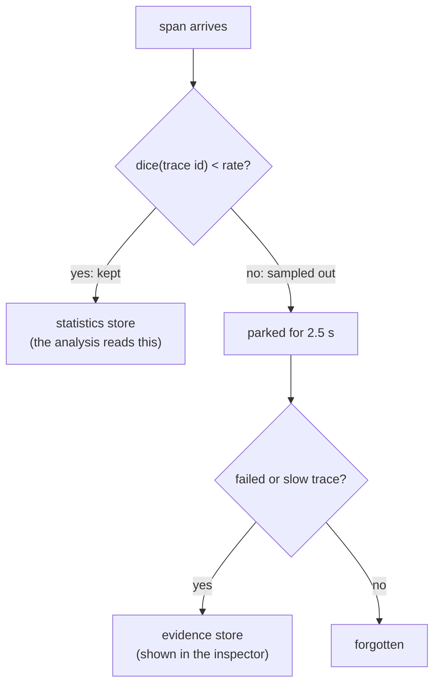
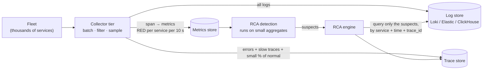

# 06 · Production guide: pushing real telemetry in, reading it, and scale

← [Back to README](../README.md)

This page answers four practical questions:

1. [How does a production system send logs and traces to this?](#1-how-production-pushes-telemetry-in)
2. [How does a person see what it does?](#2-how-a-person-sees-what-it-does)
3. [How is a log "checked against all the services"?](#3-how-is-a-log-checked-against-the-services) (short answer: it isn't)
4. [Will it fall over under huge log volume?](#4-will-it-fall-over-under-huge-volume) (short answer: yes, as built, and here is the measured limit and the fix)

## 1. How production pushes telemetry in

The engine has the same endpoints an OpenTelemetry backend has. Anything that speaks **OTLP/HTTP with JSON**
can push to it:

| Signal | Endpoint | Notes |
|---|---|---|
| Traces | `POST /v1/traces` | Used by the RCA algorithm |
| Metrics | `POST /v1/metrics` | Stored and shown at `/api/metrics`; not used for ranking |
| Logs (standard) | `POST /v1/logs` | OTLP logs; needs `service.name` on the resource |
| Logs (demo shipper) | `POST /ingest/logs` | The tiny JSON format the demo services use |

There are three realistic ways to connect a real fleet:

**A. Point the SDK straight at the engine.** For a service that already uses an OpenTelemetry SDK:

```bash
export OTEL_EXPORTER_OTLP_ENDPOINT=http://rca-engine:4318
export OTEL_EXPORTER_OTLP_PROTOCOL=http/json   # the engine parses JSON, not protobuf
export OTEL_SERVICE_NAME=payments
```

Fine for a pilot. Not recommended at scale (see part 4).

**B. Through an OpenTelemetry Collector (recommended).** The Collector is the standard "pipe" between your
fleet and any backend. It batches, filters and samples before anything reaches the engine:

```yaml
# Sketch, NOT tested against this repo. Check option names against your Collector version.
exporters:
  otlphttp/rca:
    endpoint: http://rca-engine:4318
    encoding: json            # the engine accepts JSON only
service:
  pipelines:
    traces:  { receivers: [otlp], processors: [batch], exporters: [otlphttp/rca] }
    logs:    { receivers: [otlp, filelog], processors: [filter/errors_only, batch], exporters: [otlphttp/rca] }
```

**C. Existing log files.** If services only write log files, a Collector `filelog` receiver (or Fluent Bit /
Vector) can read and forward them. Logs are only *useful* to the RCA if each line carries
**`trace_id`** and the resource carries **`service.name`**. Most OpenTelemetry logging libraries add the trace
id automatically; plain `console.log` output does not.

> What the engine needs from you: spans with `service.name`, parent/child links, and (for databases) the standard
> `db.system` attribute. If you use the standard OpenTelemetry auto-instrumentation, you already have these.

## 2. How a person sees what it does

Open **`http://<engine>:4318/`**. The page is a guided five-step walk-through:

| Step | What you do or see |
|---|---|
| 1 · Send traffic | Start or stop synthetic customer traffic |
| 2 · Break something | Inject a fault into a service or a real database |
| 3 · See the symptom | A plain-English sentence, KPIs and a latency chart for the checkout page |
| 4 · Find the cause | The verdict, the dependency graph and an "own work vs waiting" chart per service |
| 5 · Check the proof | The five scoring signals, a real slow trace, and grouped error logs |

For a real production fleet you don't need steps 1 and 2 (you'd have real traffic and real incidents): steps 3 to 5
are what you'd look at during an incident. The same data is available as JSON:

| Endpoint | Returns |
|---|---|
| `GET /api/analysis` | The ranked suspects, per-service numbers, graph and evidence |
| `GET /api/timeline?seconds=90` | Per-second numbers per service |
| `GET /api/traces?kind=slow\|error` | Example traces as waterfalls |
| `GET /api/logs?service=…&traceId=…` | Stored warn/error logs, filtered |
| `GET /api/stats` | Stored volume plus **drop counters** (see below) |

```bash
curl -s localhost:4318/api/analysis | jq '.suspects, .incident'
```

## 3. How is a log "checked against the services"?

**It isn't, and that is deliberate.** No log is ever compared against all services. What happens:

1. **On arrival:** the log's level is checked against `LOG_MIN_LEVEL` (the demo keeps everything so the
   [Everything view](07-everything-view.md) can show it; in production set `warn`). The log is stored with its `service` and `trace_id`.
2. **During analysis:** the algorithm is driven by **traces**, not logs. Logs are looked up **only for the top 3 suspects**, only
   **error-level**, only **inside the current window**, and grouped by message. That is a filter on one service, not a
   scan across all of them.
3. **On demand:** a log is joined to a request by `trace_id` (`GET /api/logs?traceId=…`). That is how "this slow request" connects
   to "the error it logged".

Logs here are **evidence**, not a detection signal. The detection runs on span timings and span errors.

## 4. Will it fall over under huge volume?

**Yes, as built, a single process cannot absorb petabytes, and it should not try.** Measured on one laptop
(`npm run bench`; synthetic 14-span traces; the load generator runs on the same machine, so treat these as order-of-magnitude):

| Measure | Result |
|---|---|
| Ingest throughput, one engine process | about **8,600 traces/s** (about **120,000 spans/s**) |
| Memory with 450k spans stored | about **490 MB** |
| Analysis with 1,000 traces in the 48 s window | 49 ms first call, 14 ms cached |
| Analysis with 5,000 traces | 154 ms first call, 70 ms cached |
| Analysis with 20,000 traces | 621 ms first call, 387 ms cached |
| Analysis with 50,000 traces | exceeds the 500k-span memory cap, so the oldest are evicted before analysis |

Two things stand out. **Ingest is cheap, analysis is the bottleneck**: it re-reads every request in the window and so grows
with traffic. At about 420 traces/s (20,000 in 48 s) a dashboard refresh already costs over half a second, and the
dashboard refreshes every 1.5 s. A busy production fleet is thousands of times beyond that.

### What the engine already does to protect itself

| Protection | Setting | Effect |
|---|---|---|
| Log level filter | `LOG_MIN_LEVEL` (demo default `info` = keep everything; **use `warn` in production**) | Drops info/debug logs at the door, since the RCA only reads errors |
| Hard memory caps | `MAX_SPANS` (500,000), `MAX_LOGS` (100,000) | Evicts the oldest data instead of growing without bound |
| Body size limit | 8 MB | Rejects oversized pushes with HTTP 413 |
| Visible counters | `GET /api/stats` → `counters` | Shows what was dropped, so loss is never silent |

These keep the process **alive and honest**. They do not make it scale.

### Sampling: what is built

The engine does **trace-ID-based sampling**, the same idea as Datadog's retention filters (a uniform sample chosen by trace ID):



* **Dice from the trace id.** `dice = last 32 bits of the trace id / 2³²`. Every span of a trace carries the same id, so every
  service's spans get the *same* decision with no coordination and no waiting: a kept trace is always complete, a dropped trace is dropped whole.
  (Sampling each span independently would leave broken traces with missing services, which makes self time meaningless.)
* **Statistics stay unbiased.** The analysis only reads the uniformly sampled traces. If it also kept *all* the slow and failed
  traces, the sample would be full of incidents and the baseline would look worse than reality.
* **Evidence is rescued separately.** A sampled-out trace is parked for 2.5 s. If it turns out to be failed or slow (>= 250 ms), it is
  promoted to an *evidence* store (max 1,000 traces) so you can still inspect it. Logs are not sampled.
* **Set it** with `TRACE_SAMPLE_RATE=0.25`, in the dashboard (step 1), or `POST /api/sampling {"rate":0.25}`.

**Trade-off:** fewer requests per window means noisier statistics. The detector needs at least 5 requests per service in a window, so at
low rates and low traffic it can go quiet. See the results in [04](04-chaos-and-evaluation.md#with-sampling-turned-on).

**What this is not:** the engine still receives 100% of spans and decides afterwards. Datadog-style systems decide at the
Collector tier, before the data reaches the engine, and compute their metrics from the *unsampled* stream. That is the part you would build next.

### How this is done at real scale

Companies with petabytes of logs do not push them into an RCA engine. The usual shape:



| Technique | What it does | Why it solves the problem |
|---|---|---|
| **Pull, don't push, logs** | Logs stay in a log store. After detection, the engine queries just the suspect service, the incident window and the trace ids. | Log volume no longer touches the engine. Cost depends on the size of the incident, not the size of the fleet. |
| **Aggregate before analysing** | A Collector "span metrics" step turns every trace into per-service numbers (request count, error count, latency histogram) every 10 s. Detection runs on those. | The data the detector reads is *constant size*, however much traffic there is. |
| **Tail-based sampling** | Keep 100% of failed and slow traces, and a small share of healthy ones. | The traces that matter are all kept; the boring majority is dropped. |
| **Shard by trace id** | Route all spans of one trace to the same processor (a load-balancing exporter keyed on trace id). | Self time needs the whole trace in one place; this lets you scale out horizontally. |
| **Stream with backpressure** | A queue (Kafka or similar) between the Collector and the engine. | Bursts are absorbed instead of dropping data or crashing. |
| **Level filtering at the edge** | Drop debug/info in the Collector. | Most log volume is info. Errors are a small fraction. |

The key idea: **the RCA needs shape, not volume.** Per-service latency and error numbers are tiny. The raw logs are
only needed for a handful of requests, after you already know where to look.

### What would change in this codebase

* Replace the in-memory `Store` with a time-series/trace store, and compute per-service buckets at ingest instead of at query time.
* Replace the per-request derivation in `analyze.ts` with queries over pre-aggregated buckets.
* Keep the scoring (`selfTime`, `errors`, `criticalPath`, `precedence`, `leaf`). It only needs per-service aggregates plus a *sample* of traces for the critical-path share.

That redesign is the natural next project, and a good thing to discuss in an interview: you can say exactly where the current design
stops scaling, with measured numbers.
