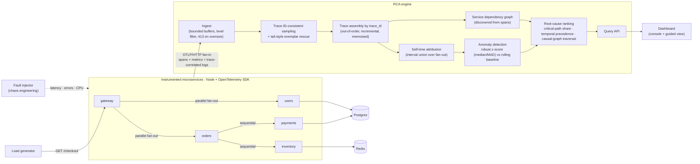

# 09 · Implemented architecture

← [Back to README](../README.md)

What this repository actually implements. For the production-scale design it is meant to grow into, see the **Proposed architecture** in the [README](../README.md#architecture). For the request flow, ports and design decisions see [01 · Architecture](01-architecture.md).

The techniques actually used, by their proper names:

| Technique | Where it shows up |
|---|---|
| **Parallel fan-out / sequential call chains** | The gateway calls `users` and `orders` concurrently; `orders` calls `payments` then `inventory`. Self time uses an **interval union**, so overlapping fan-out branches are not double counted. |
| **Fan-in and out-of-order trace assembly** | Spans from five processes arrive in separate OTLP batches in any order. They are reassembled per `trace_id` (W3C Trace Context propagation), memoised, and invalidated when a new span for that trace lands. |
| **Trace-ID-consistent sampling** | A keep/drop decision is derived from the trace id, so every service's spans get the same decision with no coordination: kept traces are always complete. |
| **Hybrid head / tail sampling** | Sampled-out traces wait in a short **pending buffer**. Failed or slow ones are **promoted to an exemplar store** and kept as evidence, while the statistics stay unbiased. |
| **Bounded buffers and load shedding** | Hard span and log caps, oldest-first eviction, level filtering at ingest, `413` on oversized pushes, and drop counters exposed at `/api/stats` (observing the observer). |
| **Query-time analysis** | Baseline-versus-window statistics are computed on demand, with robust statistics (median/MAD), **critical-path attribution**, **temporal precedence**, and a **leaf discount** over the discovered causal graph. |
| **Error-origin analysis** | Distinguishes the service where an error *originated* from services that only *propagated* it. |
| **Trace-correlated logs** | Every log line carries `trace_id`; the engine joins logs to a request across all services. |
| **Ports-and-adapters (isomorphic engine)** | The analysis and API code runs unchanged on Node and in the browser, behind a small backend interface. That is how the free static simulation mode works. |
| **Blast-radius controls** | Loopback-only binds, `READ_ONLY` mode, bearer-token ingest, strict CSP headers on the hosted demo. |
| **Chaos engineering and evaluation** | Real faults injected into services and into real Postgres/Redis, with top-1/top-3 accuracy, time-to-detect and false-alarm measurement, plus a benchmark of the engine's own limits. |
